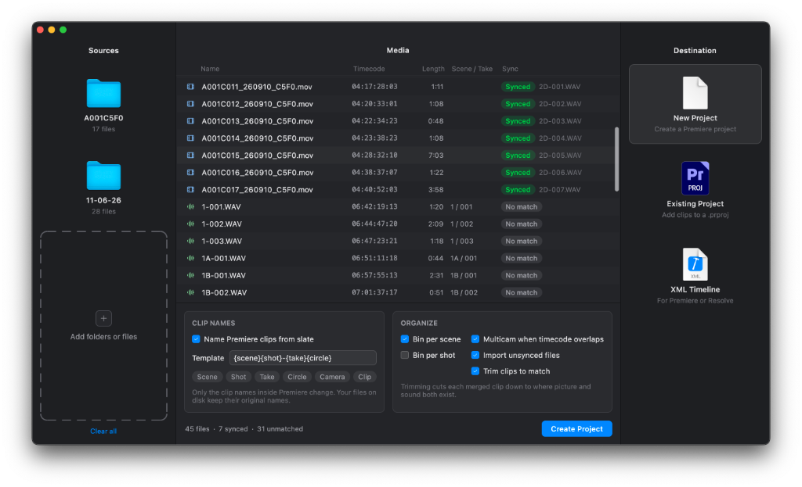
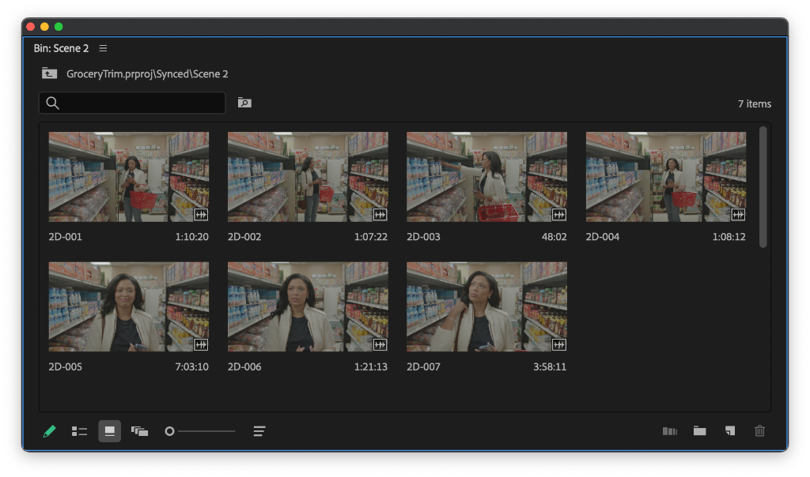

# Premiere Sync

Premiere Sync pairs production audio with camera video by timecode (or by waveform, for footage with no timecode) and writes the result as a Premiere Pro project or an XML timeline. Drop in a shoot folder and it finds the media, matches picture to sound, and groups camera angles that overlap into takes.

Clip names inside Premiere can come from slate metadata. Files on disk keep their original names.



Synced clips show up in Premiere named from the slate, grouped into a bin per scene.



## What it writes

- **New project.** A `.prproj` with merged clips and sequences in a `Synced` bin.
- **Existing project.** The same clips and sequences added to a bin you choose.
- **XML timeline.** An interchange timeline (`.xml`, FCP7/`xmeml`) for Premiere Pro or DaVinci Resolve.

A **merged clip** is Premiere's own clip type that combines one camera angle with its matched production audio. Sequences are laid out as:

- **Merged clips only** – no timeline, just the clips in their bins (Premiere projects only).
- **One synced timeline** – every take back to back in shoot order, for reviewing sync.
- **One sequence per take** – each take's camera angles and audio in their own small sequence, already aligned. Select one in Premiere and use **Create Multi-Camera Source Sequence** to finish the multicam clip.

Either one can be combined with extra sequences: **scene stringouts** (one sequence per scene, takes in slate order) and/or **a sequence per shoot day** (grouped by the date the camera or recorder actually wrote down, falling back to the file's filesystem modification time if neither device recorded one). In a `.prproj`, sequences cut from the source files in a `Source Media` bin.

Clips are trimmed to the stretch where picture and sound both exist. Files that never match can still be imported as plain clips (`.prproj` only; an XML timeline only contains synced takes).

## How matching works

Each file needs a start timecode. WAV, BWF, and RF64 audio are read directly from the Broadcast WAV `bext` and `iXML` chunks. Everything else is read with `ffprobe`, which ships inside the macOS app.

A video clip pairs with the audio file that overlaps it the most. The overlap has to be at least one second, or half the shorter clip when the clip is very short. Multicam groups angles that share that production audio, or that overlap each other and carry different camera ids.

Slate (scene, shot, take, circled take) comes from recorder metadata, camera tags such as ARRI scene and take, or the file name (`12A-3`, `S12_T3`). The default clip name is `{scene}{shot}-{take}{circle}`. Other tokens are `{camera}` and `{clip}`.

## Download

Get the Apple Silicon build from [Releases](https://github.com/sympatico-media/premiere-sound-sync/releases). It includes `ffprobe`, so nothing else needs to be installed.

## Building from source

- A recent stable [Rust](https://rustup.rs/) toolchain
- [FFmpeg](https://ffmpeg.org/) for `cargo run`, so `ffprobe` is on `PATH` (or in `/opt/homebrew/bin` or `/usr/local/bin` on macOS)

## Run

```sh
cargo run -p premiere-sound-sync
```

On macOS, this builds a `Premiere Sync.app` bundle:

```sh
scripts/bundle-macos.sh
```

Pass `debug` to bundle the debug build. The app is written to `target/release/Premiere Sync.app`. The script downloads a static arm64 `ffprobe` from [martin-riedl.de](https://ffmpeg.martin-riedl.de), checks its SHA-256, and puts it in `Contents/Resources`. Set `FFPROBE=/path/to/ffprobe` to bundle a different build. A zip for uploading to Releases is written next to the app.

### Signing for release

Without a signing identity the app is ad-hoc signed, and other Macs block it until the user clicks **Open Anyway** in System Settings > Privacy & Security. To ship a build that opens normally, sign it with a Developer ID and notarize it. This needs a paid [Apple Developer Program](https://developer.apple.com/programs/) membership.

1. In Xcode > Settings > Accounts, create a **Developer ID Application** certificate.
2. Store notarization credentials once, using an [app-specific password](https://account.apple.com):

   ```sh
   xcrun notarytool store-credentials notary --apple-id you@example.com --team-id TEAMID
   ```

3. Build, sign, notarize, and staple:

   ```sh
   SIGN_IDENTITY="Developer ID Application: Your Name (TEAMID)" NOTARY_PROFILE=notary scripts/bundle-macos.sh
   ```

Upload `target/release/Premiere Sync-<version>.zip` to Releases.

## Headless

The core crate can sync without the window. The first argument is the output path; everything after it is a file or folder to scan.

```sh
cargo run -p premiere-sound-sync-core --example sync -- episode.prproj /path/to/shoot
cargo run -p premiere-sound-sync-core --example sync -- episode.prproj --into existing.prproj /path/to/shoot
cargo run -p premiere-sound-sync-core --example sync -- timeline.xml /path/to/shoot
```

Sequence flags work with either destination, all optional:

```sh
cargo run -p premiere-sound-sync-core --example sync -- episode.prproj \
  --timeline per-take \        # none | all (default) | per-take
  --scene-stringouts \
  --day-sequences \
  /path/to/shoot
```

## Layout

| Path | Role |
| --- | --- |
| `apps/premiere-sound-sync` | Slint desktop app |
| `crates/premiere-sound-sync-core` | Scan, probe, sync, and Premiere / XML writing |
| `crates/studio-ui` | Shared interface components |
| `scripts/bundle-macos.sh` | macOS app bundle |

## License

MIT. The bundled `ffprobe` is part of [FFmpeg](https://ffmpeg.org/) and is licensed under the GPLv3. Its source is available from [ffmpeg.org](https://ffmpeg.org/download.html) and the build scripts from [martin-riedl.de](https://git.martin-riedl.de/ffmpeg/build-script).
